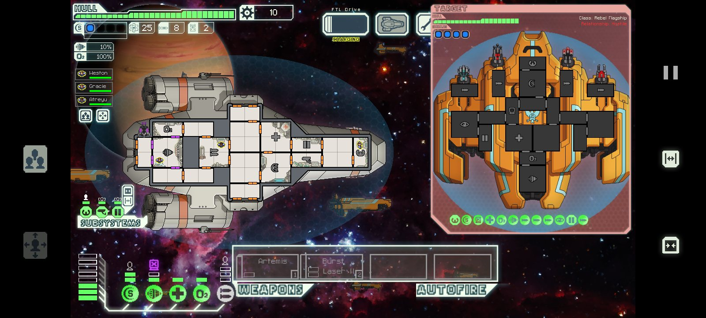
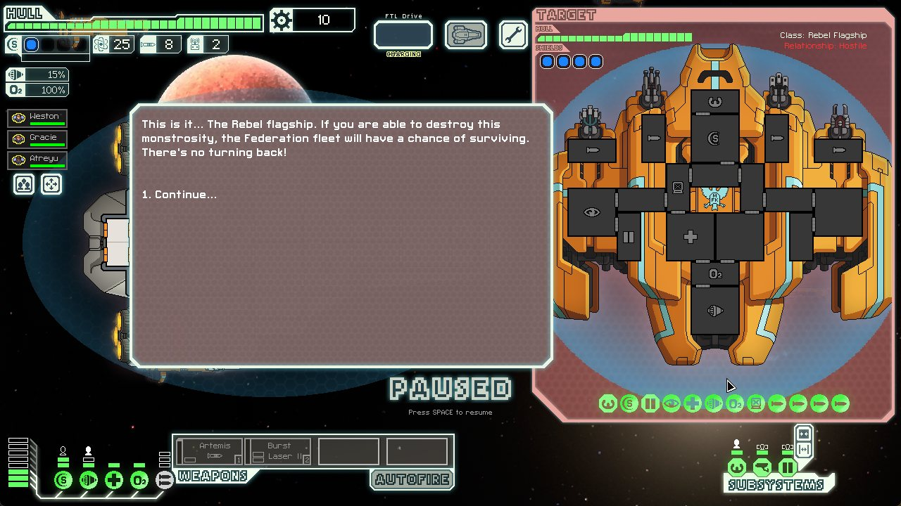
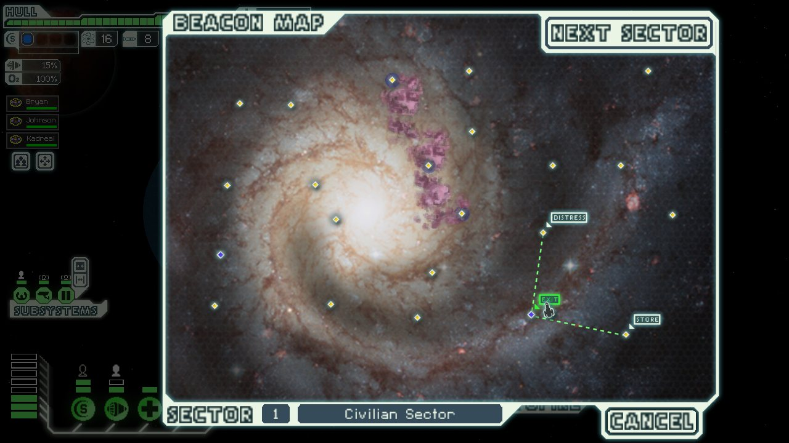
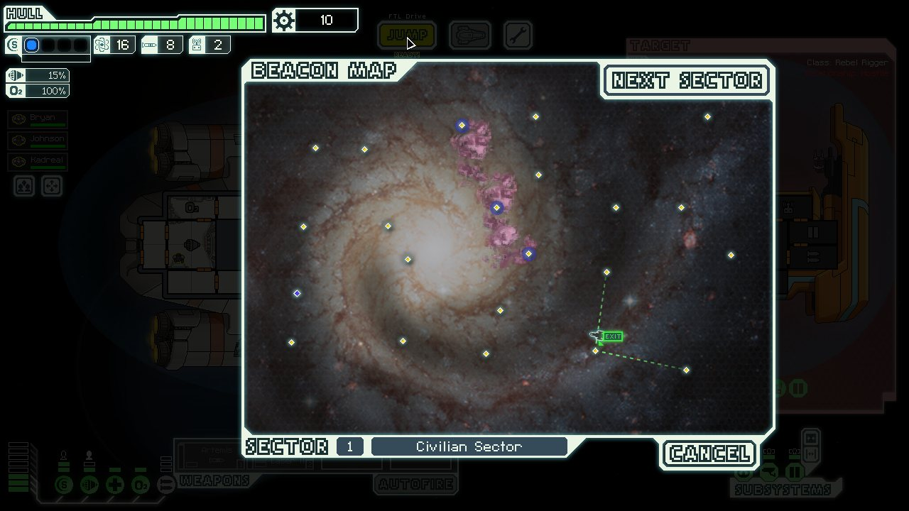
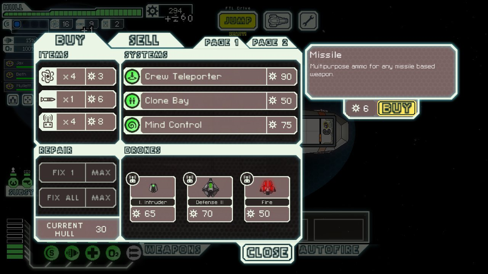
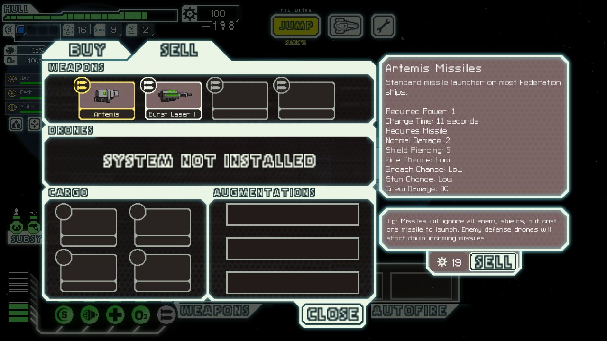
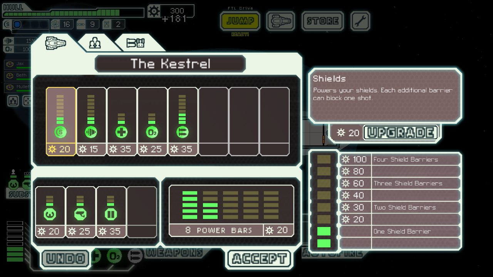
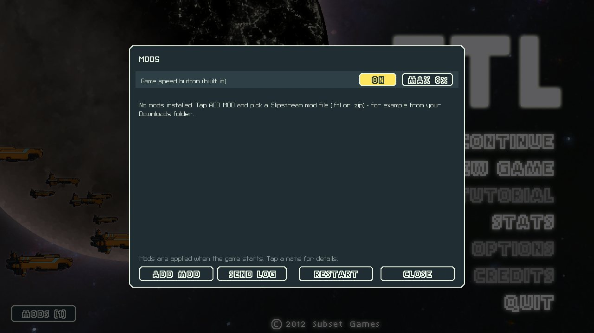

# Pocket Wormhole+

> **This is Pocket Wormhole+**, a community build of
> [Pocket Wormhole](https://github.com/adamkulik/pocket-wormhole) with fixes
> and extras that haven't been merged upstream yet. It installs **next to**
> the official app (package `com.pocketwormhole.android.plus`); move a run
> between them with EXPORT SAVE / IMPORT SAVE in the pause menu.
>
> On top of upstream it adds:
>
> - **Advanced Edition ON/OFF** in the hangar, like vanilla, with non-AE runs playable
> - **Mods**: a MODS button on the main menu to install Slipstream mods (.ftl/.zip) from a file, turn them on and off, and remove them.
>   Tested with *Enhanced Fleet Pursuit*; other Slipstream mods should work too, so try your favourites
>   (mods that use XSLT patches aren't supported, and big overhaul mods may hit engine features that aren't done yet)
> - **Game speed (optional, off by default)**: a built-in switch in the MODS panel adds a 1x-32x button next to
>   the options wrench, and sets its top speed. It isn't in vanilla: everything speeds up together, and a phone
>   that can't keep up just runs as fast as it can. Leave it off and the game runs at normal speed
> - **Updates from inside the app**: when a new release is out, the game offers it at start
>   (Update / Not now / Skip this version), downloads and checks it, and Android installs it over the old one,
>   keeping your saves. Turn it off in the MODS panel - then the app doesn't connect to the internet at all
> - **Saves between FTL on a PC and your phone, both ways**: runs continue on the same sector map, also in
>   the middle of a sector or a fight, and unlocks, achievements and records move with your profile
>   (see [Moving runs and profiles](#moving-runs-and-profiles-between-devices))
> - **Touch controls**: BUY, SELL and UPGRADE buttons with the price under an item's description,
>   tap outside the upgrades to close them, framed event choices, a vanilla main menu layout
> - **Closer to vanilla FTL 1.6.14 (PC)**, checked against the real game - measured in it, and read
>   in a decompilation of its executable:
>   sector maps and the sector tree are generated like vanilla's, from the same seeds (the same beacons,
>   nebulas and events),
>   enemy ships are generated like vanilla's (hull growing with the sector, a reactor that powers every
>   system, the same upgrade budgets and optional systems, ship types limited to their sectors),
>   scrap rewards and the starting scrap by difficulty, a surrendering enemy taking its boarders home,
>   and the last stand's WAIT button and help box
> - Crash and behaviour fixes found by playtesting and an automated test harness:
>   enemy AI power use, anti-drones, the leave-crew question, touch tooltips,
>   Return to Stations, hangar buttons, Ogg music, the Anti-Ship Battery,
>   sector generation, the last stand, saving with stale references, combat
>   drones, door punching, teleporting crew and the repair bomb.
>
> Each fix is also sent upstream as its own pull request. You still need your
> own copy of FTL's `ftl.dat` - nothing from the game is included.
>
> Most of this work was written with AI coding assistants (Claude Code and Codex)
> and then checked against vanilla FTL on a PC and playtested on a phone.

<p align="center">
  
  
  <br /><em>The same flagship fight on the phone and in FTL on a PC - the save moves both ways</em>
  <br /><br />
  
  
  <br /><em>One save, the same sector map: Pocket Wormhole+ (left) and vanilla FTL (right)</em>
  <br /><br />
  
  
  <br /><em>Touch buttons in the store: tap an item, then BUY or SELL next to its price</em>
  <br /><br />
  
  
  <br /><em>UPGRADE button for systems; the MODS panel with the optional game speed switch (off by default)</em>
</p>

## About Pocket Wormhole

A native Android port of [Project Wormhole](https://gitlab.com/znixian/xftl)
(xftl), the clean-room reimplementation of the **FTL: Faster Than Light**
engine by Campbell Suter (ZNix) and contributors. The engine is re-implemented
from scratch and loads **all game assets directly from your own `ftl.dat`** —
the exact file that ships with your Steam/GOG copy of FTL.

**No FTL assets are included.** You must own the game.
FTL: Faster Than Light is © Subset Games; this project is not affiliated
with or endorsed by them.

<p align="center">
  
  <br /><br />
  
</p>

## Installing

1. Grab the latest APK from
   [Pocket Wormhole+ releases](https://github.com/ysosrsss/pocket-wormhole/releases)
   (the official app: [its releases](https://github.com/adamkulik/pocket-wormhole/releases))
   (or build it — see below), copy it to your phone and install it (allow
   "install from unknown sources").
2. Copy `ftl.dat` from your PC's FTL install
   (`FTL Faster Than Light\ftl.dat`, ~280 MB) to the phone — anywhere you like.
3. Launch the app. On first run it asks you to pick `ftl.dat` with the system
   file picker. It copies the file into the app's private storage (one time,
   needs ~280 MB free) and then starts.
4. From Pocket Wormhole+ 0.2.7-plus.36 on, the app offers new releases itself
   when it starts (see *Updates from inside the app* above), so you only
   install it by hand once.

## Controls

| Action              | Result                                              |
|---------------------|-----------------------------------------------------|
| Tap                 | Left click                                          |
| Drag                | Mouse drag                                          |
| Long-press (~0.5 s) | Right click (move crew, power down systems, cancel) |
| Two-finger drag ↕   | Scroll wheel (ship lists, options)                  |
| Back button         | Escape (opens the pause/escape menu)                |
| Physical keyboard   | Space/Enter/arrows/Tab/Escape/letters reach the game |
| Tap a crewmember    | Selects them and auto-pauses in room-selection mode — tap a room to send them there, tap empty space to cancel |
| Tap a system icon   | Opens a power panel with big +/− buttons (drones get on/off toggles); the game auto-pauses |
| Tap a weapon to fire | Auto-pauses in targeting mode — your ship shrinks out of the way and the enemy ship goes full-size; tap rooms to target (drag for beams), long-press to cancel |
| In the store        | Tap an item to select it: its description appears with the price and a BUY button, and only BUY buys it. On the sell tab a tap shows SELL the same way, or drag the item to the sell box |
| In the upgrades     | Tap a system or the reactor to select it, then UPGRADE (with the price) upgrades it; UNDO still works. Tapping outside the window closes it, like ACCEPT |
| On the maps         | First tap on a beacon or sector just inspects it; tap the same one again to confirm. Tapping a different one moves the highlight, tapping empty space clears it. Event choices and the pause menu stay single-tap |

## Saves & data

Everything lives in the app's internal private storage (`Context.filesDir`,
`/data/data/com.pocketwormhole.android.plus/files/`), which file managers can't
open without root:

- `ftl.dat` — the copied game data
- `ProjectWormhole/save-profile.xml` — profile (unlocks, achievements, options)
- `ProjectWormhole/run-save.xml` — your in-progress run
- `ProjectWormhole/continue.sav` — the same run in vanilla's format, for export
  (`continue-imported.sav` is the last imported file)
- `ProjectWormhole/ftl-path.txt` — pointer to the copied `ftl.dat`
- `ProjectWormhole/mods/` — mods (with an `order.txt` listing them); add and
  remove them with the MODS button on the main menu
- `log-session-*.txt` — session logs (useful for bug reports); SEND LOG in the
  MODS panel exports them, and they are also written to
  `/Android/data/com.pocketwormhole.android.plus/files/`, which you can reach
  over USB or with a file manager on most Android versions

**Save + Quit** (escape menu) saves your run; CONTINUE on the main menu resumes
it where you left it. Starting a new run or dying discards the saved one, as in
vanilla FTL.

## Moving runs and profiles between devices

### Optional PC save folder

Available in source/test builds; planned for the next Plus release.

This exchanges your current run automatically through a folder. PW+ writes and
loads the save; a separate Syncthing installation transfers the file between devices.
You do not need a cloud storage account. This option is off until you choose a folder.

**Set up once (Windows and Android)**

1. Close/save the game on both devices. Install [Syncthing on the PC](https://syncthing.net/downloads/)
   and [Syncthing-Fork on Android](https://github.com/researchxxl/syncthing-android/releases).
   Pair the devices by adding their Device IDs and accepting the connection on both.
   See Syncthing's [getting started guide](https://docs.syncthing.net/intro/getting-started.html)
   for the pairing screens.
2. In Syncthing on the PC, add the **existing FTL save folder**:
   `Documents\My Games\FasterThanLight`. Share it with the phone. On the phone, accept
   that shared folder and choose a normal local directory, for example
   `Documents/FTL-Sync`. Both sides use the same Syncthing **Folder ID**, but their
   paths and display names can differ. Set the folder type to **Send & Receive** on both.
3. In that folder's **Ignore Patterns** on **both devices**, use these two lines:

   ```text
   !continue.sav
   *
   ```

   This shares only the current run. It leaves `ae_prof.sav`, `settings.ini`, and
   other files alone. Enter the patterns on both sides: Syncthing does not transfer
   `.stignore` itself. See [Syncthing's ignore patterns](https://docs.syncthing.net/users/ignoring.html).
4. Let Syncthing reach **Up to Date** before enabling the folder in PW+. Open
   **MODS → PC save folder → SET UP** and select the **same phone directory** from
   step 2, not the PC path or the private Android app directory. Android remembers
   this folder permission, so you do not pick a file each time.
5. Choose which run to start with if asked. **Load PC save** loads the file already
   brought from the PC. **Use phone save** sends the phone's current run to that
   folder instead. **Not now** lets you decide later.

**Each time you switch devices**

- **PC → phone:** Save & Quit in FTL, wait for Syncthing to say **Up to Date**, then
  open PW+ and accept **Load PC save**.
- **Phone → PC:** Save & Quit in PW+, wait for Syncthing to say **Up to Date**, then
  open FTL on the PC and choose **Continue**. On PC, Syncthing uses FTL's actual save
  folder, so there is no manual copying or import step.

Keep both devices online together until the transfer finishes, and play on one
device at a time. An offline save stays on its device until Syncthing reconnects;
writing to the phone folder does not mean the PC has received it yet. Use the same
game data and compatible mods on both sides.

When the game saves (including jumps and Save & Quit), it exports `continue.sav`
to the chosen folder. On returning to the app, and while it is open, PW+ checks
for a changed PC save and asks before loading it. The game pauses for that choice.
If both devices have changes, choose **Load PC save**, **Use phone save**, or
**Not now**. Not now keeps both versions and stops automatic uploads over the PC
version. Removing the PC save also stops uploads until you choose what to keep.
Ending a phone run removes the shared save only if it has not changed on the PC.

This option exchanges the current run only; `ae_prof.sav` still uses the manual
profile import/export below. The phone keeps its full native save privately, and
keeps private backups before replacing saves. A missing folder permission or a
failed transfer leaves the local save in place; reconnect through **MANAGE**.
**MANAGE → More → Disconnect folder** stops folder exchange without deleting saves.

If no PC save appears, check that Syncthing is running on both devices, the shared
folder is **Up to Date**, and PW+ has the same phone directory selected. If the
phone stops syncing in the background, check Syncthing-Fork's run conditions and
Android battery settings. **MANAGE → More → Check now** retries a deferred choice.

Checked with the Android and Windows Syncthing cores and vanilla FTL 1.6.14:
phone export → PC load → a real jump → phone import, plus an offline phone save
and reconnection, an invalid PC file, and a synced deletion. Physical-phone
background behaviour depends on its Android settings.

### Manual transfer

### Runs (EXPORT / IMPORT SAVE)

**EXPORT SAVE** in the pause menu saves the game as it is now to a
vanilla-compatible `continue.sav`, at any time. Vanilla FTL 1.6.14+ or another
Pocket Wormhole install can continue it. **IMPORT SAVE** loads such a file.
A `continue.sav` can also be loaded from the main menu: STATS → PROFILE →
IMPORT FROM FTL.

FTL on a PC keeps its saves in `Documents\My Games\FasterThanLight` on Windows,
`~/.local/share/FasterThanLight` on Linux and
`~/Library/Application Support/FasterThanLight` on a Mac. Back up the file
that's already there first.

What carries over, in both directions:

- Ship, crew on their squares, weapons, scrap, the sector and the route taken,
  stores, quests and story flags, seen beacons and the fleet's progress
- The sector map: both games build the same map from the save's seeds, with
  your ship on its beacon, also in the middle of a sector
- Advanced Edition on or off
- A fight in progress: the enemy ship with its hull, systems, weapons, drones,
  crew and AI state, and the last stand's flagship with its position and stage,
  and its guns with their charge
- A ship that's still at the beacon, friendly ships too
- The weapons' charge, crew waiting in the clonebay, drones that are on (they
  launch again, without using a part) and a hacking probe that has landed,
  yours or the enemy's, with its pulse
- Crew on the other ship: your boarders and the enemy's, where they stand
- Stunned crew with the time left, mind-controlled crew with the time left
  and who controls them, and damaged doors
- Fires, and the beacon's sun, pulsar or asteroid field

> **⚠️ What to watch out for:**
>
> - **IMPORT SAVE replaces your current run.** It asks first, and if the file
>   can't be loaded it says so and you stay in the current run.
> - **Install the same mods on both sides.** A save made with a mod you don't
>   have (or the other way round) may not load.
> - **Moments in a fight don't carry over**: projectiles in the air are dropped,
>   and so is a hacking probe that hasn't landed yet. Drones start their flight
>   again.
> - **An open event doesn't carry over with its choices.** FTL shows the
>   event's text again when it loads the save.
> - **Exports from Pocket Wormhole v0.2.4 or older are broken** and will
>   *hang vanilla FTL* on load. Re-export the run with a newer version
>   (every Pocket Wormhole+ release is newer).
> - Crew statistics (repairs, kills, evasions, jumps) are zeroed in exports.
> - `run-save.xml` — the engine-native save — is **not** a transfer format.
>   Use EXPORT SAVE.

### Profile (unlocks, achievements, records)

Runs and the profile are separate files. STATS → PROFILE on the main menu moves
the profile: **IMPORT FROM FTL** adds what's in FTL's `ae_prof.sav` to this one,
and **EXPORT FOR FTL** saves an `ae_prof.sav` with everything from both. It goes
in the same folder as the saves; back up the old one first.

## Known limitations

- XSLT-based mod patches are unsupported (Saxon doesn't run on Android);
  vanilla data and most Slipstream mods work fine.
- Requires Android 8.0+ (API 26) and a GLES 3.0 GPU (everything from ~2014 on).
- The hangar ship editor UI is mouse-centric; it works with touch but is fiddly.
- Hover-dependent desktop UI (tooltips) only shows while you're touching —
  except in the store, maps and upgrades, where a tap keeps the info up
  (see Controls above).

## Building from source

Prerequisites: JDK 17, Android SDK (platform 34, build-tools 34.0.0).

```
./gradlew assembleDebug        # Linux/macOS
gradlew.bat assembleDebug      # Windows
```

The APK lands in `app/build/outputs/apk/debug/`.

`local.properties` is created by Android Studio, or write it yourself:
`sdk.dir=<path to your Android SDK>`.

### How it works

The engine (`xyz.znix.xftl`), Slipstream (`net.vhati.*`) and patched
jorbis/PNGDecoder sources are compiled into the app; the desktop LWJGL layer
is replaced by small Android-backed shims:

- `org.lwjgl.opengl.*` — GL11..GL30 → `android.opengl.GLES30` (the engine's
  renderer is GL 3.0-core, mapping 1:1 onto GLES 3); each frame is drawn into
  an offscreen framebuffer with a guaranteed depth+stencil attachment
- `org.lwjgl.openal.*` — a software OpenAL implementation (SoftAL) mixing to
  an `AudioTrack`, including buffer-queue streaming for music and
  `AL_SEC_OFFSET` seeking
- `org.lwjgl.glfw.GLFW` — key constants; windowing is replaced by
  `AndroidGameContainer` (GLSurfaceView) and `AndroidInput` (touch → mouse,
  with a one-frame click deferral so the engine's draw-time hover state is
  correct for instant taps)
- `org.newdawn.slick.*` — the Slick2D classes the engine uses (decoders,
  listeners, geometry), with Android-backed implementations

Patches to the upstream engine are kept minimal; see the source comments and
git history.

## Credits & licences

See [NOTICE.md](NOTICE.md) for the full list. In short:

- [Project Wormhole](https://gitlab.com/znixian/xftl) — Campbell Suter (ZNix)
  and contributors (GPL-2.0+)
- [Slipstream Mod Manager](https://github.com/Vhati/Slipstream-Mod-Manager) —
  Vhati and contributors (GPL-2.0)
- [JOrbis/JOgg](http://www.jcraft.com/jorbis/) — JCraft (LGPL-2.1)
- PNGDecoder — Matthias Mann (BSD-3-clause)
- **FTL: Faster Than Light** — © Subset Games. This project ships none of its
  assets; load them from your own copy.

## Licence

This project is free software: you may redistribute and/or modify it under
the terms of the [GNU General Public License v2.0](LICENSE), or (at your
option) any later version.
